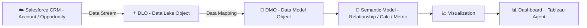
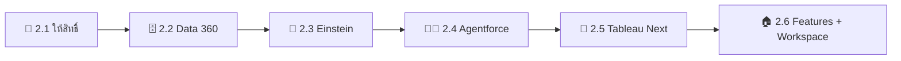

# 🚀 คู่มือสร้าง Demo Tableau Next แบบ End-to-End

> ทำตามทีละคลิก ตั้งแต่ขอ Salesforce Demo Org จนได้ Dashboard บน Tableau Next ที่ข้อมูลไหลมาจาก CRM จริง ผ่านเส้นทาง **CRM ➜ DLO ➜ DMO ➜ Semantic Model ➜ Dashboard** พร้อมจุดตรวจ ✅ ทุกช่วง


> [!IMPORTANT]
> **อัปเดตล่าสุด: 9 ตุลาคม 2026** ชื่อปุ่มหรือชื่อ Field อาจต่างเล็กน้อยตาม Release ของ Salesforce และบางหน้าจอยังแสดงชื่อ **Data Cloud** แทน **Data 360** ถ้าหน้าจอไม่ตรง ให้ยึด **"เป้าหมายของขั้นตอน"** เป็นหลัก

> [!NOTE]
> **⚖️ ข้อจำกัดความรับผิดชอบ (Disclaimer)**
>
> เอกสารนี้จัดทำขึ้นจากการรวบรวมข้อมูลโดยส่วนตัวของผู้เขียน เพื่อวัตถุประสงค์ในการแบ่งปันความรู้เท่านั้น มิใช่เอกสารทางการของเจ้าของผลิตภัณฑ์ และไม่สามารถใช้เป็นเอกสารอ้างอิงทางการค้าได้ หากต้องการนำข้อมูลไปใช้อ้างอิง กรุณาตรวจสอบข้อมูลล่าสุดจากเว็บไซต์ทางการของเจ้าของผลิตภัณฑ์อีกครั้ง
>
> *This document is a personal compilation intended for knowledge-sharing purposes only. It is not official documentation from the product owner and shall not be used as a commercial reference. Please verify all information against the product owner's official website before use.*

> [!TIP]
> 🙏 **เครดิต:** ช่วงที่ 1 และ 2 อ้างอิงจาก [คู่มือการ Activate Tableau Next](https://github.com/natareecharoen/activate-tableau-next-guide) ช่วงที่ 3 ถึง 8 เป็นส่วนต่อยอด

---

## 🧭 สารบัญ

| | ช่วง | หัวข้อ | ⏱️ เวลาโดยประมาณ |
|:---:|---|---|:---:|
| 🗺️ | [ภาพรวม](#️-ภาพรวมการไหลของข้อมูล) | การไหลของข้อมูล | – |
| 1️⃣ | [ขอ SDO Org](#1️⃣-ช่วงที่-1-ขอ-sdo-org) | 🔑 ขอ Demo Org | 15 นาที + รออีเมล |
| 2️⃣ | [เปิดระบบ](#2️⃣-ช่วงที่-2-เปิดระบบที่จำเป็น) | ⚙️ เปิดระบบที่จำเป็น | 45 นาที |
| 3️⃣ | [ข้อมูล CRM](#3️⃣-ช่วงที่-3-สร้างข้อมูล-crm) | 📝 สร้างข้อมูลตัวอย่าง | 15 นาที |
| 4️⃣ | [CRM ➜ DLO](#4️⃣-ช่วงที่-4-crm--dlo) | 📥 ดึงข้อมูลเข้า Data 360 | 20 นาที + รอ Sync |
| 5️⃣ | [DLO ➜ DMO](#5️⃣-ช่วงที่-5-dlo--dmo) | 🔀 Map เป็นข้อมูลมาตรฐาน | 20 นาที |
| 6️⃣ | [Semantic Model](#6️⃣-ช่วงที่-6-semantic-model) | 🧠 สร้างชั้นนิยามธุรกิจ | 30 นาที |
| 7️⃣ | [Dashboard](#7️⃣-ช่วงที่-7-visualization-และ-dashboard) | 📊 Visualization และ Dashboard | 30 นาที |
| 8️⃣ | [ทดสอบ](#8️⃣-ช่วงที่-8-ทดสอบ-end-to-end) | 🎯 ทดสอบ End-to-End | 15 นาที |
| 🛠️ | [แก้ปัญหา](#️-แก้ปัญหาที่พบบ่อย) | อาการและวิธีแก้ | – |
| 📚 | [อ้างอิง](#-แหล่งอ้างอิง) | แหล่งข้อมูล | – |

---

## 🗺️ ภาพรวมการไหลของข้อมูล



| ชั้น | คืออะไร | อยู่ที่ไหน |
|---|---|---|
| ☁️ **CRM** | ข้อมูลต้นทางที่ผู้ใช้กรอก | App Sales |
| 🗄️ **DLO** | ข้อมูลดิบที่ดึงเข้ามา โครงสร้างเหมือนต้นทาง | Data 360 |
| 🧱 **DMO** | ข้อมูลที่จัดเข้ามาตรฐานกลางแล้ว | Data 360 |
| 🧠 **Semantic Model** | ชั้นความหมายทางธุรกิจ (ความสัมพันธ์ สูตร ตัวชี้วัด) | Tableau Next |
| 📊 **Dashboard** | สิ่งที่ผู้ใช้ปลายทางเห็น | Tableau Next |

> [!TIP]
> ถ้ายังไม่คุ้นกับ DLO / DMO แนะนำอ่าน [Tableau Semantics คืออะไร](https://github.com/thenaritlab/tableau-semantics-guide) ก่อนเริ่ม

📎 อ้างอิง: [Understanding Salesforce and Data Cloud Terms (Tableau Help)](https://help.tableau.com/current/tableau-next/en-us/tableau_next_sf_datacloud_terms.htm)

---

## 1️⃣ ช่วงที่ 1: ขอ SDO Org

| ขั้นตอน | สิ่งที่ทำ |
|:---:|---|
| 1 | เปิด [Partner Learning Camp: Demo Org](https://partnerlearningcamp.salesforce.com/s/demo-org) แล้ว Login ด้วย Account Partner |
| 2 | กด **Request for a Demo Org** |
| 3 | ช่อง Demo Type เลือก **SDO** |
| 4 | กรอก Username ที่ไม่ซ้ำใคร เช่น `yourname.tnext@demo.example` (รูปแบบอีเมล แต่ไม่ต้องเป็นอีเมลจริง) |
| 5 | กด **Submit** |
| 6 | เปิดอีเมลจาก Salesforce กดลิงก์ ตั้งรหัสผ่าน แล้ว Login |

> [!TIP]
> 📒 จด **Username, Password และวันหมดอายุของ Org** เก็บไว้ทันที

> [!NOTE]
> ✅ **จุดตรวจ:** เข้าหน้า Home ของ Salesforce ได้

📎 อ้างอิง: [คู่มือการ Activate Tableau Next](https://github.com/natareecharoen/activate-tableau-next-guide)

[⬆️ กลับสารบัญ](#-สารบัญ)

---

## 2️⃣ ช่วงที่ 2: เปิดระบบที่จำเป็น

> [!IMPORTANT]
> ทำตามลำดับ **2.1 ถึง 2.6 อย่าสลับ** โดยเฉพาะ **Agentforce (2.4) ต้องเปิดก่อน Tableau Next (2.5)**



### 2.1 👤 ให้สิทธิ์ตัวเอง

| ขั้นตอน | สิ่งที่ทำ |
|:---:|---|
| 1 | มุมขวาบน กดเฟือง ⚙️ ▸ **Setup** |
| 2 | ช่อง Quick Find ซ้ายมือ พิมพ์ `Users` ▸ กด **Users** |
| 3 | กดที่ชื่อ User ของตัวเอง (ไม่ใช่ปุ่ม Edit) |
| 4 | เลื่อนลงหา **Permission Set Assignments** ▸ กด **Edit Assignments** |
| 5 | ช่องซ้าย เลือก **Data Cloud Architect** กดลูกศร Add แล้วทำซ้ำกับ **Tableau Next Admin** |
| 6 | กด **Save** |

### 2.2 🗄️ เปิด Data 360

| ขั้นตอน | สิ่งที่ทำ |
|:---:|---|
| 1 | Refresh หน้า Setup หนึ่งครั้ง |
| 2 | Quick Find พิมพ์ `Data Cloud Setup` ▸ กดเข้าไป |
| 3 | กด **Get Started** แล้วรอจนขึ้นว่าเสร็จ |

> [!TIP]
> ⏳ ระหว่างรอ Provision เปิด Tab ใหม่ทำข้อ 2.3 ต่อได้เลย

### 2.3 🤖 เปิด Einstein

| ขั้นตอน | สิ่งที่ทำ |
|:---:|---|
| 1 | Quick Find พิมพ์ `Einstein Setup` ▸ เปิด Toggle **Turn on Einstein** |
| 2 | ในหน้าเดียวกัน กด **Go to Einstein Trust Layer** ▸ เปิด **Large Language Model Data Masking** |
| 3 | Quick Find พิมพ์ `Einstein Audit` ▸ เข้า **Einstein Audit, Analytics, and Monitoring Setup** ▸ เปิด **Audit and Feedback** |

### 2.4 🧑‍💼 เปิด Agentforce

| ขั้นตอน | สิ่งที่ทำ |
|:---:|---|
| 1 | Quick Find พิมพ์ `Agentforce Agents` |
| 2 | เปิด Toggle **Agentforce Agents** |

### 2.5 🚀 เปิด Tableau Next

| ขั้นตอน | สิ่งที่ทำ |
|:---:|---|
| 1 | Quick Find พิมพ์ `Tableau Next Setup` |
| 2 | เปิด Toggle **Enable Tableau Next** |
| 3 | ในส่วน Setup Steps เปิด **Turn On AI Features** |
| 4 | กด **Go to Tableau Next** มุมขวาบน |

### 2.6 🏠 เปิด Features และสร้าง Workspace

| ขั้นตอน | สิ่งที่ทำ |
|:---:|---|
| 1 | หน้า Home ของ Tableau Next เลือก **Administrator** |
| 2 | **Settings** ▸ **Tableau Next Features** |
| 3 | เปิด 3 ตัว: **Tableau Agent**, **Data Analysis**, **Semantic Model Curation** |
| 4 | กลับหน้า Administration ▸ **Create Workspace** ▸ ตั้งชื่อ `Sales Demo Workspace` |

> [!TIP]
> 🔄 ถ้าหา Toggle ไม่เจอหลังเปิด Einstein ให้ **Logout แล้ว Login ใหม่** หนึ่งรอบ

> [!NOTE]
> ✅ **จุดตรวจ:**
> - เห็น Workspace ใน Tableau Next
> - App Launcher (จุด 9 จุดมุมซ้ายบน) ค้นคำว่า `Data Cloud` แล้วเจอ App

📎 อ้างอิง: [คู่มือการ Activate Tableau Next](https://github.com/natareecharoen/activate-tableau-next-guide) · [Tableau Next Setup Guide: Activate Salesforce Org](https://help.tableau.com/current/tableau-next/th-th/tableau_next_setup_guide_activate_salesforce.htm) · [Tableau Next Setup Guide: Configure Data Cloud](https://help.tableau.com/current/tableau-next/th-th/tableau_next_setup_guide_configure_data_cloud.htm)

[⬆️ กลับสารบัญ](#-สารบัญ)

---

## 3️⃣ ช่วงที่ 3: สร้างข้อมูล CRM

SDO มีข้อมูลตัวอย่างอยู่แล้ว ขั้นนี้ **เพิ่มข้อมูลของเราเอง** เพื่อใช้ตามรอยไปจนถึง Dashboard

### 3.1 🏢 สร้าง Account

| ขั้นตอน | สิ่งที่ทำ |
|:---:|---|
| 1 | App Launcher ▸ พิมพ์ `Sales` ▸ เปิด App **Sales** |
| 2 | แท็บ **Accounts** ▸ **New** |
| 3 | Account Name: `Demo Plant` · Industry: `Manufacturing` |
| 4 | กด **Save** |

### 3.2 💼 สร้าง Opportunity 3 รายการ

แท็บ **Opportunities** ▸ **New** แล้วกรอกทีละรายการตามตาราง

| Opportunity Name | Account | Amount | Close Date | Stage |
|---|---|---:|---|---|
| `DEMO-01 Analytics License` | Demo Plant | 500,000 | สิ้นเดือนนี้ | Prospecting |
| `DEMO-02 Data Platform` | Demo Plant | 1,200,000 | เดือนหน้า | Negotiation |
| `DEMO-03 Training` | Demo Plant | 150,000 | วันนี้ | Closed Won |
| **รวม** | | **1,850,000** | | |

> [!NOTE]
> ✅ **จุดตรวจ:** เปิด Account `Demo Plant` แล้วเห็น Opportunity 3 รายการใน Related List (ยอดรวม **1,850,000**)

[⬆️ กลับสารบัญ](#-สารบัญ)

---

## 4️⃣ ช่วงที่ 4: CRM ➜ DLO

| ขั้นตอน | สิ่งที่ทำ |
|:---:|---|
| 1 | App Launcher ▸ เปิด **Data Cloud** |
| 2 | แท็บ **Data Streams** ตรวจก่อนว่ามี Stream ของ Account และ Opportunity อยู่แล้วหรือไม่ |

> [!NOTE]
> 🎁 SDO บางตัวเตรียม Data Stream มาให้แล้ว ถ้ามีและสถานะเป็น **Success** ให้ข้ามไป [ช่วงที่ 5](#5️⃣-ช่วงที่-5-dlo--dmo)

ถ้ายังไม่มี Data Stream ให้สร้างใหม่

| ขั้นตอน | สิ่งที่ทำ |
|:---:|---|
| 3 | กด **New** |
| 4 | เลือก **Salesforce CRM** ▸ **Next** |
| 5 | Salesforce Org เลือก Org ปัจจุบัน |
| 6 | เลือก **Data Bundles** ▸ ติ๊ก **Sales** ▸ **Next** |
| 7 | หน้ารายการ Field ปล่อยค่า Default ▸ **Next** |
| 8 | Data Space เลือก **default** ▸ กด **Deploy** |
| 9 | กลับมาแท็บ Data Streams รอจนคอลัมน์ **Last Run Status** ของทุก Stream เป็น **Success** |

> [!TIP]
> 📦 Bundle **Sales** รวม Account, Contact, Lead, Opportunity, User และ **Map ไป DMO ให้อัตโนมัติ** ทำให้ช่วงที่ 5 เหลือแค่ตรวจสอบ

> [!NOTE]
> ✅ **จุดตรวจ:**
> 1. แท็บ **Data Explorer**
> 2. Object เลือก **Data Lake Object** แล้วเลือกตัวที่ชื่อขึ้นต้นด้วย Opportunity
> 3. หาแถว `DEMO-01 Analytics License` ถ้าเจอ แปลว่าข้อมูลถึง DLO แล้ว

> [!WARNING]
> ถ้าไม่เจอ ให้เปิด Stream ของ Opportunity แล้วกด **Refresh Now** รอ 5–10 นาที **รอบแรกใช้เวลานานกว่ารอบถัดไป**

📎 อ้างอิง: [Tableau Next Setup Guide: Configure Data Cloud](https://help.tableau.com/current/tableau-next/th-th/tableau_next_setup_guide_configure_data_cloud.htm) · [Ingest Contacts Using the CRM Connector (Salesforce Developers Workshop)](https://developer.salesforce.com/workshops/agentforce-new-workshop/data-cloud/1-ingest-crm-contacts)

[⬆️ กลับสารบัญ](#-สารบัญ)

---

## 5️⃣ ช่วงที่ 5: DLO ➜ DMO

### 5.1 🔍 ตรวจ Mapping

| ขั้นตอน | สิ่งที่ทำ |
|:---:|---|
| 1 | แท็บ **Data Streams** ▸ กดชื่อ Stream ของ Opportunity |
| 2 | ดูกรอบ **Data Mapping** ด้านขวา ถ้า Map แล้ว กด **Review** ดูเส้นเชื่อม |
| 3 | ตรวจว่า Field ต่อไปนี้มีเส้นเชื่อมไป DMO **Opportunity** (ดูตารางด้านล่าง) |
| 4 | ทำซ้ำกับ Stream ของ Account (ตรวจ Id, Name, Industry) |

| Field ใน DLO | ใช้ทำอะไร |
|---|---|
| `Id` | 🔑 Primary Key |
| `Name` | ชื่อดีล |
| `Amount` | มูลค่า |
| `StageName` | สถานะ |
| `CloseDate` | วันปิดดีล |
| `AccountId` | เชื่อมไป Account |

### 5.2 🧩 ถ้ายังไม่ได้ Map

ใช้กรณีที่เลือก Object เองโดยไม่ใช้ Bundle

| ขั้นตอน | สิ่งที่ทำ |
|:---:|---|
| 1 | ในกรอบ Data Mapping กด **Start** |
| 2 | กด **Select Objects** ▸ แท็บ Standard Data Model ▸ ค้นหา `Opportunity` ▸ ติ๊ก ▸ **Done** |
| 3 | กด Field ฝั่งซ้าย (DLO) แล้วกด Field ฝั่งขวา (DMO) ที่ตรงกัน ทีละคู่ ตามตารางข้างบน |
| 4 | กด **Save** |

### 5.3 🔗 ตรวจ Relationship

| ขั้นตอน | สิ่งที่ทำ |
|:---:|---|
| 1 | แท็บ **Data Model** ▸ กด **Opportunity** ▸ แท็บ **Relationships** |
| 2 | ต้องมีบรรทัดที่เชื่อม Opportunity (Field Account) ไป Account (Field Account Id) |
| 3 | ถ้าไม่มี กด **Edit** ▸ **New Relationship** เลือกสองฝั่งนี้ Cardinality เป็น **Many to One** |

> [!NOTE]
> ✅ **จุดตรวจ:** Data Explorer ▸ Object เลือก **Data Model Object** ▸ **Opportunity** แล้วเจอ `DEMO-01` ถึง `DEMO-03` ครบ 3 รายการ

📎 อ้างอิง: [Import and Map Data (Trailhead)](https://trailhead.salesforce.com/content/learn/modules/data-activation-in-marketing-cloud-next/import-and-map-data) · [Object Model in Data 360 (Salesforce Developers)](https://developer.salesforce.com/docs/data/data-cloud-dev/guide/dc-object-model.html)

[⬆️ กลับสารบัญ](#-สารบัญ)

---

## 6️⃣ ช่วงที่ 6: Semantic Model

### 6.1 📦 สร้าง Model

| ขั้นตอน | สิ่งที่ทำ |
|:---:|---|
| 1 | App Launcher ▸ **Tableau Next** ▸ เปิด `Sales Demo Workspace` |
| 2 | กด **New** (หรือ **Add**) ▸ **Semantic Model** ▸ เลือกสร้างใหม่จากศูนย์ |
| 3 | ตั้งชื่อ `Sales Pipeline Model` · Data Space: **default** |
| 4 | หน้าเลือกข้อมูล เลือกประเภท **Data Model Objects** ▸ ติ๊ก **Opportunity** และ **Account** ▸ ยืนยัน |

### 6.2 🔗 สร้าง Relationship

| ขั้นตอน | สิ่งที่ทำ |
|:---:|---|
| 1 | บน Canvas ลากจากกล่อง Opportunity ไปกล่อง Account |
| 2 | เลือก Field: `Opportunity.Account` = `Account.Account Id` |
| 3 | กด **Apply** |

### 6.3 🧮 สร้าง Calculated Field

กด **+** ข้างรายการ Field ▸ **Calculated Field** ประเภท Measurement

| ชื่อ | สูตร |
|---|---|
| `Won Amount` | `IF [Opportunity Stage] = 'Closed Won' THEN [Total Amount] END` |
| `Open Pipeline` | `IF NOT CONTAINS([Opportunity Stage], 'Closed') THEN [Total Amount] END` |

> [!TIP]
> ⌨️ ชื่อ Field ในวงเล็บ `[ ]` ให้ **เลือกจากรายการที่ระบบแนะนำขณะพิมพ์** อย่าพิมพ์เอง เพราะชื่อจริงใน Org อาจต่างจากตัวอย่าง

### 6.4 📏 สร้าง Metric

| ช่อง | ค่า |
|---|---|
| เมนู | **New** ▸ **Metric** |
| ชื่อ | `Pipeline Amount` |
| Measure | `Open Pipeline` (Sum) |
| Time Dimension | **Close Date** |

### 6.5 📝 ใส่ Description

กดที่ Field สำคัญ (**Total Amount, Opportunity Stage, Close Date**) แล้วใส่ **Description** สั้น ๆ เป็นภาษาอังกฤษ เช่น `Deal value in THB` จากนั้นกด **Save**

> [!IMPORTANT]
> 🤖 **Tableau Agent ใช้ Description เหล่านี้ในการตีความคำถาม** ยิ่งเขียนชัด คำตอบยิ่งแม่น

> [!NOTE]
> ✅ **จุดตรวจ:** กดดู Preview ของ Opportunity ใน Model แล้วเห็นข้อมูลขึ้น ไม่มี Error สีแดงที่ Relationship

📎 อ้างอิง: [Semantic Models in Tableau Next Quick Look (Trailhead)](https://trailhead.salesforce.com/content/learn/modules/semantic-models-in-tableau-next-quick-look/get-to-know-semantic-models) · [Tableau Next: Building a Semantic Model (The Data School)](https://www.thedataschool.co.uk/rosh-khan/tableau-next-building-a-semantic-model)

[⬆️ กลับสารบัญ](#-สารบัญ)

---

## 7️⃣ ช่วงที่ 7: Visualization และ Dashboard

### 7.1 📈 สร้าง Visualization 3 ตัว

แต่ละตัวเริ่มจาก: ใน Workspace กด **New** ▸ **Visualization** ▸ เลือก `Sales Pipeline Model`

| ชื่อ | Rows | Columns | ชนิดกราฟ | หมายเหตุ |
|---|---|---|:---:|---|
| `Pipeline by Stage` | Opportunity Stage | Total Amount | 📊 Bar | – |
| `Amount by Month` | Total Amount | Close Date | 📈 Line | ตั้งระดับวันที่เป็น Month |
| `Top Accounts` | Account Name | Total Amount | 📊 Bar | เรียงมากไปน้อย |

ตั้งชื่อตามตารางแล้วกด **Save** ทุกตัว

### 7.2 🧩 ประกอบ Dashboard

| ขั้นตอน | สิ่งที่ทำ |
|:---:|---|
| 1 | **New** ▸ **Dashboard** ▸ ชื่อ `Sales Pipeline Dashboard` |
| 2 | จากแผงซ้าย ลาก **Metric** `Pipeline Amount` วางแถวบนสุด |
| 3 | ลาก Visualization ทั้ง 3 ตัววางด้านล่าง |
| 4 | ลาก **Filter** เลือก Field Opportunity Stage วางด้านบน |
| 5 | กด **Save** แล้วกด **Preview** หรือ **View** |

```text
┌──────────────────────────────────────────────────────────┐
│ Sales Pipeline Dashboard          [Opportunity Stage ▼]  │
├──────────────────────────────────────────────────────────┤
│ 📏 Pipeline Amount (Metric)                              │
├────────────────────────────┬─────────────────────────────┤
│ Pipeline by Stage (Bar)    │ Amount by Month (Line)      │
├────────────────────────────┴─────────────────────────────┤
│ Top Accounts (Bar เรียงมากไปน้อย)                         │
└──────────────────────────────────────────────────────────┘
```

> [!NOTE]
> ✅ **จุดตรวจ:** ในกราฟ `Top Accounts` เห็น `Demo Plant` ยอดรวม **1,850,000**

[⬆️ กลับสารบัญ](#-สารบัญ)

---

## 8️⃣ ช่วงที่ 8: ทดสอบ End-to-End

> [!TIP]
> 🌟 **ไฮไลต์ตอนโชว์ลูกค้า:** แสดงให้เห็นว่า **แก้ที่ต้นทาง แล้วปลายทางเปลี่ยนตาม**

| ขั้นตอน | สิ่งที่ทำ |
|:---:|---|
| 1 | กลับ App **Sales** ▸ เปิด `DEMO-01 Analytics License` ▸ แก้ Amount เป็น `900,000` ▸ **Save** |
| 2 | ไป **Data Cloud** ▸ Data Streams ▸ Stream Opportunity ▸ **Refresh Now** |
| 3 | รอ Last Run Status เป็น **Success** |
| 4 | เปิด Dashboard แล้ว Refresh |
| 5 | เปิด **Tableau Agent** ใน Workspace แล้วลองถามคำถามด้านล่าง |

| รายการ | ก่อนแก้ | หลังแก้ |
|---|---:|---:|
| DEMO-01 | 500,000 | **900,000** |
| ยอดรวม Demo Plant | 1,850,000 | **2,250,000** |

```text
What is the total pipeline amount by stage?
```

> [!NOTE]
> ✅ **จุดตรวจ:** ยอดใน Dashboard เปลี่ยนเป็น **2,250,000** และ Agent ตอบตัวเลขตรงกับกราฟ

[⬆️ กลับสารบัญ](#-สารบัญ)

---

## 🛠️ แก้ปัญหาที่พบบ่อย

| อาการ | วิธีแก้ |
|---|---|
| ไม่เห็นเมนู Data Cloud Setup | ตรวจว่า Assign **Data Cloud Architect** แล้ว จากนั้น Refresh หรือ Login ใหม่ |
| Data Stream ไม่มี Object ให้เลือก | Setup ▸ Permission Sets ▸ ตัวของ Data Cloud Salesforce Connector ▸ เพิ่มสิทธิ์ Read ให้ Object และ Field นั้น |
| DLO มีข้อมูล แต่ DMO ว่าง | Mapping ยังไม่ครบหรือยังไม่ได้ Save โดยเฉพาะ Primary Key (`Id`) |
| Semantic Model ไม่เห็น DMO | ตรวจว่า Data Space ตรงกัน (**default**) |
| Tableau Agent ไม่ขึ้น | ตรวจข้อ 2.4, 2.5 (Turn On AI Features) และ 2.6 |
| ตัวเลขใน Dashboard ไม่อัปเดต | กด **Refresh Now** ที่ Data Stream แล้วรอสถานะ **Success** ก่อน Refresh Dashboard |

> [!CAUTION]
> ⏰ **Demo Org มีวันหมดอายุ** ตรวจวันที่ในอีเมลจาก Partner Learning Camp และเตรียม Org ล่วงหน้า **อย่างน้อย 1 วัน** ก่อน Demo จริง

[⬆️ กลับสารบัญ](#-สารบัญ)

---

## 📚 แหล่งอ้างอิง

ตรวจสอบเมื่อ **9 ตุลาคม 2026**

| แหล่ง | เนื้อหา |
|---|---|
| [คู่มือการ Activate Tableau Next](https://github.com/natareecharoen/activate-tableau-next-guide) | ขั้นตอนขอ Org และเปิดระบบ (ช่วงที่ 1–2) |
| [Tableau Next Setup Guide: Activate Salesforce Org](https://help.tableau.com/current/tableau-next/th-th/tableau_next_setup_guide_activate_salesforce.htm) | เปิดใช้งาน Salesforce Org สำหรับ Tableau Next |
| [Tableau Next Setup Guide: Configure Data Cloud](https://help.tableau.com/current/tableau-next/th-th/tableau_next_setup_guide_configure_data_cloud.htm) | ตั้งค่า Data 360 (Data Cloud) |
| [Ingest Contacts Using the CRM Connector (Salesforce Developers Workshop)](https://developer.salesforce.com/workshops/agentforce-new-workshop/data-cloud/1-ingest-crm-contacts) | สร้าง Data Stream จาก Salesforce CRM |
| [Import and Map Data (Trailhead)](https://trailhead.salesforce.com/content/learn/modules/data-activation-in-marketing-cloud-next/import-and-map-data) | Data Mapping จาก DLO ไป DMO |
| [Object Model in Data 360 (Salesforce Developers)](https://developer.salesforce.com/docs/data/data-cloud-dev/guide/dc-object-model.html) | โครงสร้าง DLO / DMO |
| [Understanding Salesforce and Data Cloud Terms (Tableau Help)](https://help.tableau.com/current/tableau-next/en-us/tableau_next_sf_datacloud_terms.htm) | คำศัพท์ Data 360 |
| [Semantic Models in Tableau Next Quick Look (Trailhead)](https://trailhead.salesforce.com/content/learn/modules/semantic-models-in-tableau-next-quick-look/get-to-know-semantic-models) | พื้นฐาน Semantic Model |
| [Tableau Next: Building a Semantic Model (The Data School)](https://www.thedataschool.co.uk/rosh-khan/tableau-next-building-a-semantic-model) | ขั้นตอนสร้าง Model พร้อม Screenshot |

---

[⬆️ กลับไปด้านบน](#-คู่มือสร้าง-demo-tableau-next-แบบ-end-to-end)

> [!NOTE]
> **⚖️ ข้อจำกัดความรับผิดชอบ (Disclaimer)**
>
> เอกสารนี้จัดทำขึ้นจากการรวบรวมข้อมูลโดยส่วนตัวของผู้เขียน เพื่อวัตถุประสงค์ในการแบ่งปันความรู้เท่านั้น มิใช่เอกสารทางการของเจ้าของผลิตภัณฑ์ และไม่สามารถใช้เป็นเอกสารอ้างอิงทางการค้าได้ หากต้องการนำข้อมูลไปใช้อ้างอิง กรุณาตรวจสอบข้อมูลล่าสุดจากเว็บไซต์ทางการของเจ้าของผลิตภัณฑ์อีกครั้ง
>
> *This document is a personal compilation intended for knowledge-sharing purposes only. It is not official documentation from the product owner and shall not be used as a commercial reference. Please verify all information against the product owner's official website before use.*

**Created by The Narit Lab**
